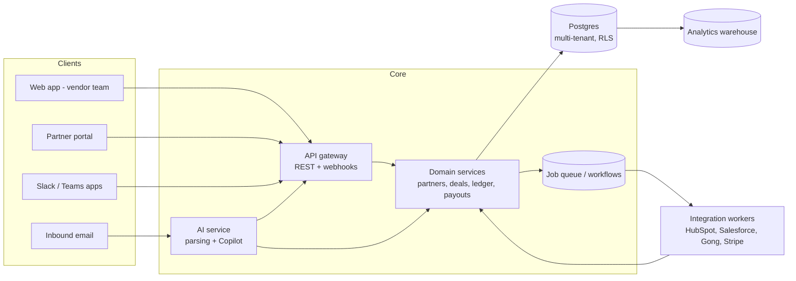

# Covalent: product and company blueprint

Working name: **Covalent**. In a covalent bond, two parties share what they have, and that is the product idea: a vendor and its partners working from one shared record. Check the name for trademark and domain availability before using it publicly. The name appears in only a few places in the code, so changing it is easy.

This document goes with the concept site (`index.html`) and the clickable prototype (`app.html`). It covers what we are building, why it can win, and what the backend needs to look like when engineering starts.

---

## 1. Thesis

> Partnerships are the cheapest source of pipeline in B2B SaaS, but they are also the hardest to prove. Whoever owns the trusted record of partner influence also owns the partner budget.

Most partner relationship management (PRM) tools digitize deal registration and give partners a portal. They answer "who registered first?" Covalent answers the questions executives actually ask:

| Who asks | Their question | What answers it in Covalent |
|---|---|---|
| CFO | Which partners actually drive revenue? | **Partner Ledger**: every touch on every deal, with evidence, credited under an attribution model the company chooses |
| CRO | Why did most of our partners go quiet? | **Partner Pulse**: a weekly health score and automatic re-engagement plays |
| Partners | When do I get paid, and how much? | **Payout Autopilot**: statements built from the Ledger, with the math visible to the partner |
| AEs | Who can help me win this account? | **Overlap Radar**: built-in account mapping shown on every opportunity |

## 2. Who it is for

**Ideal customer:** B2B SaaS companies from Series A to public, with 10 to a few thousand partners, running on HubSpot or Salesforce.

**Buyer:** Head of Partnerships, VP Channel, or Alliances lead.
**Daily users:** partner managers, channel sales, RevOps.
**Also involved:** AEs (see partner context in the CRM), finance (approves payouts), and the partners themselves.

**Partner types to support from day one:** referral, reseller, agency, systems integrator, managed service provider, technology/integration partner, and marketplace.

## 3. Where the market is today

I couldn't load the two inspiration sites from this environment, so the notes below come from general product knowledge. Check them against the live sites.

| Category | Examples | Strength | Gap Covalent exploits |
|---|---|---|---|
| CRM-embedded PRM | Introw | Lives next to HubSpot/Salesforce; fast to adopt | Focused on co-selling; attribution is mostly "sourced"; partners still use a portal |
| Portal-first PRM | Kiflo, and enterprise suites | Covers onboarding, deal registration, LMS and commissions; affordable at the low end | Partners must log in, so adoption decays; influence isn't measured |
| Account mapping | Crossbeam / Reveal | Network of shared account data | A separate tool and a separate budget; doesn't run the program |
| Affiliate / referral platforms | Various | Payouts at scale | Built for consumer-style affiliates, not B2B co-selling |
| Spreadsheets + CRM fields | Everyone at first | Free | No history, no trust, no automation |

**Positioning line:** *Covalent is the partner relationship platform that proves every partner-sourced and partner-influenced dollar, and that partners can use without ever logging in.*

## 4. What makes it unique

1. **Partner Ledger (the moat).** An append-only record of partner touches (intros, joint calls, technical validation, procurement help), each with evidence pulled from the CRM, calendar, call recorder, Slack or email. Attribution models (weighted, first touch, even split, sourced only, custom) are applied on top. Finance can audit it; partners can see their slice. Once a company's partner revenue reporting runs on the Ledger, replacing Covalent becomes expensive.
2. **Anywhere Registration (the adoption unlock).** Partners register deals and log touches from Slack, Microsoft Teams, email or their own CRM. AI turns the message into a structured registration. Partner portals have chronically low usage, so going portal-optional is the single biggest lever on program activity.
3. **Overlap Radar (built in, not bolted on).** Account mapping using hashed domains, surfaced on each opportunity, plus an "ask for intro" action. It replaces a separate tool for most customers.
4. **Partner Pulse + Copilot (the manager's leverage).** Health scores flag partners going dormant. Copilot drafts QBRs, explains score changes and suggests which partner to bring into a deal. One partner manager can then cover far more partners.
5. **The network play (the billion-dollar path).** A partner agency often works with 5 to 20 SaaS vendors. When several of them use Covalent, that partner gets one **Partner Inbox**: one place to register deals, track earnings and see overlaps across all its vendors. Each new vendor brings partners in, and each partner pulls more vendors in. Single-tenant PRMs can't build this, because the partner identity lives inside each vendor's account.

## 5. Product modules by lifecycle stage

| Stage | Module | MVP? | In prototype |
|---|---|---|---|
| Recruit | Application forms, fit scoring from overlap, routing | Yes (forms + manual scoring) | Applications |
| Onboard | Program agreements, e-signature, checklists, shared channel setup | Yes (checklist), e-sign later | Partner drawer lifecycle |
| Enable | Courses, certifications, assets with win-rate tracking | Phase 2 | Enablement, Partner view > Learn |
| Co-market | MDF requests and claims, campaign kits, lead attribution | Phase 3 | Co-marketing |
| Co-sell | Deal registration (portal, Slack, email, CRM), conflict detection, Overlap Radar | Yes (portal + Slack + conflicts) | Deal registrations, Overlap Radar |
| Reward | Commission rules, statements, approvals, payments | Yes (statements), payments Phase 3 | Payouts, Partner view > Earnings |
| Grow | Tiers, Pulse, QBRs, Copilot | Pulse v1 in Phase 2 | Home, Partner drawer, Copilot |

## 6. Pricing (concept)

| Plan | Price | Limit | Key features |
|---|---|---|---|
| Launch | Free | 10 partners | Deal registration, portal, one CRM sync |
| Growth | ~$690/mo, billed yearly | 100 partners | Ledger, Slack/email registration, enablement, statements |
| Scale | ~$1,900/mo, billed yearly | Unlimited | Overlap Radar, Pulse, Copilot, MDF, Stripe Connect payouts |
| Enterprise | Custom | — | Custom attribution, SSO/SCIM, data residency, sandbox |

Partner seats are always free, so nothing discourages adding partners. A later revenue line is a small fee on payouts processed through Covalent.

## 7. Go-to-market

1. **Design partners (next 3 months):** 8 to 12 partner leaders. Interview each one, walk them through the prototype, and offer founder pricing for life.
2. **HubSpot App Marketplace first,** then Salesforce AppExchange. That is where the buyers already look.
3. **Partner-led, naturally:** recruit agencies and SIs who serve many SaaS vendors. Every vendor they bring onto Covalent feeds the network.
4. **Content wedge:** an annual "State of Partner Attribution" benchmark built from anonymized Ledger data, once there is enough of it.

## 8. Roadmap (about 18 months)

| Phase | Timing | Goal | Scope |
|---|---|---|---|
| 0. Concept | Now to Q1 2027 | Validate | This site and prototype, design-partner interviews, waitlist |
| 1. MVP | +3 to 6 months | First paying customers | HubSpot sync, partner directory, portal + Slack registration, conflict detection, Ledger v1 (CRM + Slack touches, weighted model), payout statements |
| 2. Product-market fit | +6 to 10 months | Retention | Salesforce, email and Teams registration with AI parsing, enablement, Pulse v1, tiers, partner-facing earnings |
| 3. Scale | +10 to 14 months | Expansion revenue | Overlap Radar, Copilot, MDF, Stripe Connect payouts, custom attribution models |
| 4. Network | +14 to 18 months | Moat | Partner Inbox across vendors, partner directory/marketplace, benchmarks |

## 9. Metrics that matter

- **North star:** partner-influenced ARR recorded in the Ledger, summed across all customers
- Weekly active partners as a share of all partners (target: well above typical portal usage)
- Median time from partner close to payout
- Registrations created outside the portal (share)
- Net revenue retention of Covalent customers

---

## 10. Backend blueprint

This section is for the engineering team. The prototype's `data.js` follows the same resource shapes, so the frontend can switch to a real API without changing its structure.

### 10.1 Architecture



**Suggested stack:** TypeScript end to end (Node API, React frontend), Postgres with row-level security for tenant isolation, a durable workflow engine for syncs and payouts (Temporal or a Postgres-backed queue to start), object storage for evidence files, and a warehouse (BigQuery or Snowflake) for reporting. The Claude API handles registration parsing and Copilot, with tool use over a read-only query layer, so the model can only see what the signed-in user is allowed to see.

### 10.2 Core principles

1. **The CRM stays the system of record for deals.** Covalent mirrors accounts and opportunities and writes back only partner fields (partner, credit, registration status).
2. **The Ledger is append-only.** Touches are never edited in place. A correction is a new entry that reverses the old one, so the audit trail always holds.
3. **Credit is derived, not stored by hand.** Credit allocations are recomputed from touches and the active attribution model, and cached per deal.
4. **A partner is an organization that exists across tenants.** A partner org can hold memberships with many vendor tenants. That is what makes the Partner Inbox possible later.
5. **Overlap matching never exposes raw lists.** Normalize company domains and hash them with a key unique to each vendor–partner pair. Only matches both sides agreed to share are revealed. Private set intersection can come later for enterprise.

### 10.3 Data model (first pass)

| Entity | Key fields | Notes |
|---|---|---|
| `tenant` | id, name, crm_type, plan | One per vendor company |
| `user` | id, tenant_id, role | Vendor-side users |
| `partner_org` | id, name, domain, type | Global, not owned by one tenant |
| `partner_user` | id, partner_org_id, email, slack_id | Partner people; magic-link or Slack identity |
| `membership` | tenant_id, partner_org_id, program_id, tier_id, status, owner_user_id, joined_at | The vendor–partner relationship; status = Recruiting, Onboarding, Enabling, Co-selling, Growing |
| `program` / `tier` | rates, requirements, benefits | Commission rates live on tier and program |
| `application` | tenant_id, partner_org fields, fit_score, overlap_count, source, decision | Recruit stage |
| `account` / `opportunity` | crm_id, name, domain, amount, stage, owner | Mirrored from CRM |
| `registration` | membership_id, account fields, est_amount, close_date, via (portal, slack, teams, email, crm), status, raw_message | Raw message kept for AI-parsed entries |
| `conflict` | registration_id, kind (ae_owned, other_partner, existing_customer), resolution, resolved_by | |
| `touch` | id, tenant_id, opportunity_id, partner_org_id, kind (sourced, influenced, assisted), occurred_at, source (slack, gong, crm, calendar, partner_log), evidence_ref, created_by, reverses_touch_id | Ledger entry, append-only |
| `attribution_model` | tenant_id, type, weights_json, active | |
| `credit_allocation` | opportunity_id, partner_org_id, model_id, share, computed_at | Derived cache |
| `commission_rule` | program_id, tier_id, kind, rate, caps | |
| `statement` / `statement_line` | membership_id, period, status; line: opportunity_id, arr, share, rate, amount | Built from closed-won plus credit |
| `payment` | statement_id, provider (stripe_connect, export), status, paid_at | |
| `course`, `enrollment`, `certification` | | Enable stage |
| `asset`, `asset_event` | event type, opportunity_id | Win-rate tracking |
| `mdf_request`, `campaign`, `lead` | | Co-market stage |
| `health_snapshot` | membership_id, week, score, factors_json | Pulse |
| `overlap_match` | tenant_id, partner_org_id, hashed_domain, vendor_status, partner_status | |
| `intro_request` | opportunity_id, partner_org_id, status | |
| `audit_log` | actor, action, entity, before/after | Every write |

### 10.4 API surface (v1 sketch)

```
GET    /v1/partners                     list memberships (filters: status, tier, health)
GET    /v1/partners/:id                 membership + partner org + health + deals
POST   /v1/applications/:id/accept      creates membership in Onboarding
POST   /v1/registrations                portal, Slack and email all end up here
POST   /v1/registrations/:id/approve
POST   /v1/registrations/:id/resolve    { resolution: split | award | assist | decline }
GET    /v1/opportunities/:id/ledger     touches + credit under the requested model
POST   /v1/touches                      log a touch (with evidence)
GET    /v1/ledger/credit?model=&scope=  credited ARR by partner
GET    /v1/overlap                      matrix for open pipeline
POST   /v1/intro-requests
GET    /v1/statements?status=
POST   /v1/statements/approve           batch approval
POST   /v1/copilot/ask                  question in, answer + cited sources out
Webhooks out: registration.created, registration.approved, touch.created, statement.approved, partner.health_changed
```

### 10.5 Integrations, in build order

1. HubSpot (OAuth app: companies, deals, owners, custom properties for partner fields)
2. Slack (slash command, shortcuts, Slack Connect channel per partner)
3. Inbound email (a parse address per tenant)
4. Salesforce (managed package or connected app)
5. Gong or other call recorders (meetings with partner attendees become touches)
6. Google and Microsoft calendars
7. Microsoft Teams
8. Stripe Connect (partner payouts), plus CSV export for AP tools

### 10.6 Security and compliance

- Tenant isolation through Postgres row-level security, checked on every query
- SSO (SAML/OIDC) and SCIM on Enterprise; magic links for partners
- Field-level controls on what partners can see about a deal
- SOC 2 Type I before the first enterprise deal, Type II within 12 months
- EU data residency as an Enterprise option

## 11. Open questions for the founder

1. Which partner type should the first design partners focus on: referral/agency (fast to sell) or reseller/SI (bigger deals)?
2. HubSpot-first or Salesforce-first? HubSpot is the faster path to early customers, and Salesforce is where enterprise budgets are.
3. Should Covalent process payouts itself (a revenue line, but money-movement compliance) or only calculate them at first?
4. Is the name Covalent available and does it feel right, or should we explore others?

## 12. Files in this folder

| File | What it is |
|---|---|
| `index.html`, `site.js` | Marketing site: positioning, lifecycle, differentiators, ROI estimate, pricing, waitlist |
| `app.html`, `app.js`, `app.css`, `data.js` | Clickable product prototype with vendor and partner views and sample data |
| `brand.css` | Shared design tokens (colors, type, light and dark themes) and base components |
| `BLUEPRINT.md` | This document |
